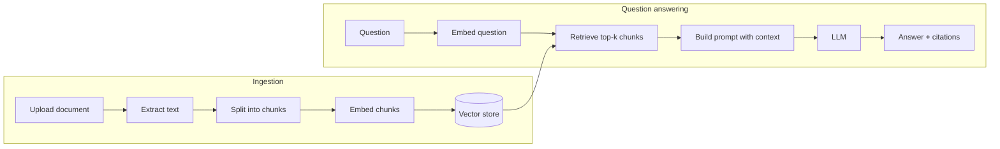

# Docs RAG

[](https://github.com/NicolasCardenass/docs-rag/actions/workflows/ci.yml)

> 🇧🇷 Resumo em português no [final deste arquivo](#resumo-em-português).

**Chat with your documents.** Upload PDFs, text or Markdown files and ask questions in natural
language; answers are generated by an LLM grounded on the most relevant passages of your documents,
with citations pointing back to the sources.

> 🚧 Work in progress — see the [roadmap](./ROADMAP.md).

## How it works

Docs RAG implements **retrieval-augmented generation (RAG)**:



1. **Ingestion** — text is extracted from each document, split into overlapping chunks and converted
   into embeddings stored in a vector database.
2. **Retrieval** — the question is embedded and the most similar chunks are retrieved.
3. **Generation** — the LLM answers using only the retrieved context and cites which chunks it used.

## Planned stack

| Part     | Technologies                                                                     |
| -------- | -------------------------------------------------------------------------------- |
| Backend  | Python 3.12, FastAPI, Pydantic, ChromaDB                                         |
| AI       | Pluggable embedding and LLM providers: mock (default), OpenAI, Anthropic, Ollama |
| Frontend | Next.js, TypeScript, Tailwind CSS                                                |
| Tooling  | uv, ruff, mypy, pytest, Docker, GitHub Actions                                   |

The default **mock** providers are deterministic, so the whole app runs and is tested without any
API key; real providers are selected with environment variables.

## Repository layout

```text
docs-rag/
├── backend/    # Python API (FastAPI)
└── frontend/   # Web UI (Next.js)
```

## Getting started

### With Docker (recommended)

```bash
docker compose up --build
```

Open <http://localhost:3000> for the app and <http://localhost:8000/docs> for the API docs. Data is
kept in the `docs-rag-data` volume. The app uses the offline mock providers by default; to use a
real model, copy `backend/.env.example` to `backend/.env`, set the provider and API key, and run the
command again.

### Local development

See [backend/README.md](./backend/README.md) and [frontend/README.md](./frontend/README.md).

## License

[MIT](./LICENSE) © Nicolas Cardenas

---

## Resumo em português

**Docs RAG** permite conversar com seus documentos: você envia PDFs, textos ou arquivos Markdown e
faz perguntas em linguagem natural. As respostas são geradas por um LLM com base nos trechos mais
relevantes dos documentos (técnica de RAG, _retrieval-augmented generation_), sempre citando as
fontes. O projeto está em desenvolvimento; o progresso está no [roadmap](./ROADMAP.md).
