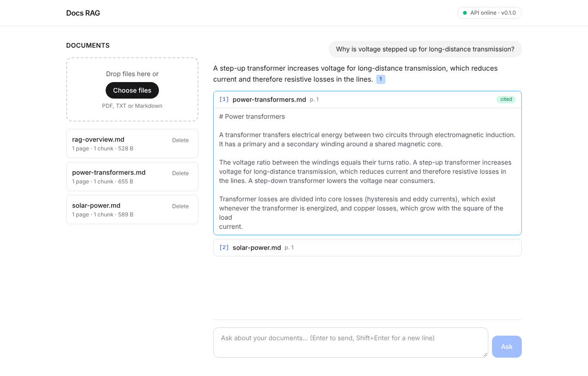
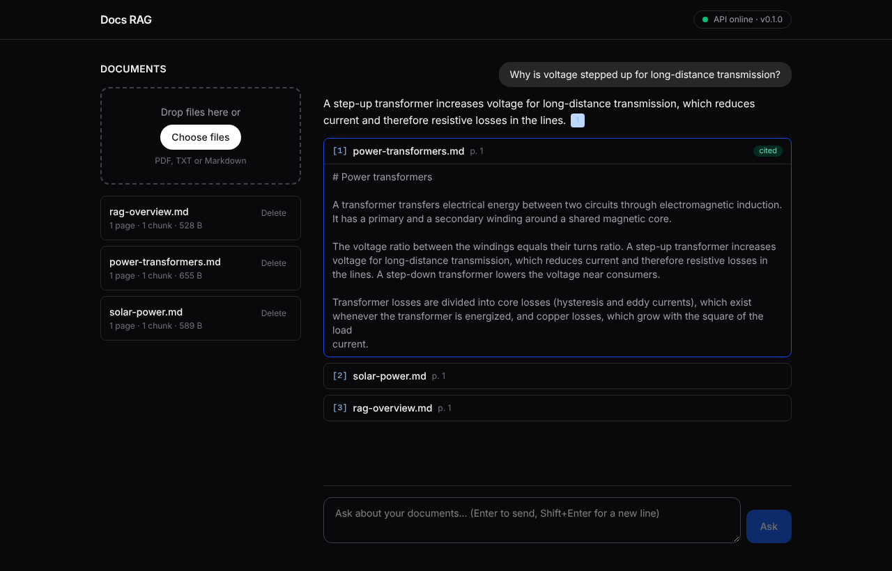
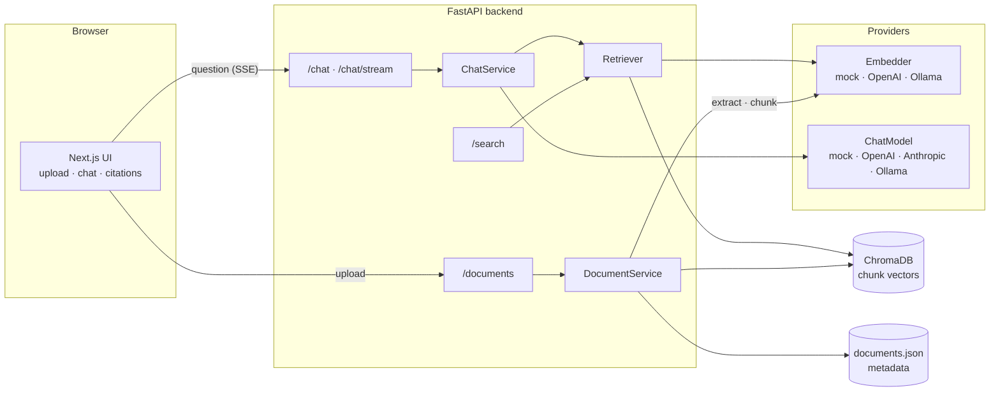

# Docs RAG

[](https://github.com/NicolasCardenass/docs-rag/actions/workflows/ci.yml)
[](./LICENSE)

> 🇧🇷 Resumo em português no [final deste arquivo](#resumo-em-português).

**Chat with your documents.** Upload PDFs, text or Markdown files and ask questions in natural
language. Answers are generated by an LLM grounded on the most relevant passages of your documents,
streamed as they are written, with clickable citations pointing back to the exact passage, file and
page.



## Features

- **Document ingestion** — PDF (page by page), plain text and Markdown; text normalization,
  encoding fallback and clear errors for unsupported, empty or corrupted files.
- **Smart chunking** — overlapping chunks that end at natural boundaries (paragraph, sentence,
  word), validated with property-based tests.
- **Semantic search** — embeddings stored in ChromaDB, cosine similarity, top-k and per-document
  filters.
- **Grounded answers with citations** — the LLM answers only from retrieved passages and cites them
  as `[n]`; invalid citations are ignored and the model is not called when nothing relevant is
  found.
- **Streaming** — answers are streamed with Server-Sent Events and can be stopped from the UI.
- **Pluggable providers** — embeddings (mock, OpenAI, Ollama) and LLMs (mock, OpenAI, Anthropic,
  Ollama) selected by environment variables. The default mock providers run fully offline.
- **Evaluation** — a labelled question set and a script reporting hit rate@k, MRR, citation accuracy
  and keyword coverage.
- **Production-minded** — typed configuration, strict typing, 100+ tests, Docker images, compose
  setup and a CI pipeline that builds and smoke-tests the containers.

<p align="center">
  
</p>

## Architecture



**Ingestion:** extract text → split into overlapping chunks → embed → store vectors and metadata.
**Question answering:** embed the question → retrieve the top-k chunks → build a prompt with
numbered passages → the LLM answers citing `[n]` → the answer is streamed with its sources.

Every external dependency sits behind a small interface (`Embedder`, `VectorStore`, `ChatModel`),
and services are wired in one place (`create_app`). Swapping a provider is a configuration change,
and tests use fakes without touching the network.

## Tech stack

| Part     | Technologies                                                             |
| -------- | ------------------------------------------------------------------------ |
| Backend  | Python 3.12, FastAPI, Pydantic, pydantic-settings, ChromaDB, pypdf       |
| AI       | OpenAI, Anthropic and Ollama providers, plus deterministic offline mocks |
| Frontend | Next.js (App Router), React, TypeScript, Tailwind CSS                    |
| Quality  | pytest, Hypothesis, ruff, mypy (strict), ESLint, Prettier                |
| Delivery | uv, Docker (multi-stage, non-root), docker compose, GitHub Actions       |

## Getting started

### With Docker (recommended)

```bash
docker compose up --build
```

Open <http://localhost:3000> for the app and <http://localhost:8000/docs> for the interactive API
documentation. Data is kept in the `docs-rag-data` volume.

The app runs with the offline mock providers by default. To use real models, copy
`backend/.env.example` to `backend/.env`, set for example:

```dotenv
DOCS_RAG_EMBEDDING_PROVIDER=openai
DOCS_RAG_LLM_PROVIDER=anthropic
DOCS_RAG_OPENAI_API_KEY=...
DOCS_RAG_ANTHROPIC_API_KEY=...
```

and run the command again. For fully local models, use `ollama` for both providers. Changing the
embedding provider requires re-uploading documents, since vectors from different models cannot be
compared (the app refuses to mix them).

### Local development

```bash
# Backend (http://localhost:8000)
cd backend && uv sync && uv run uvicorn docs_rag.main:app --reload

# Frontend (http://localhost:3000), in another terminal
cd frontend && npm install && npm run dev
```

See [backend/README.md](./backend/README.md) for the API reference, configuration, streaming
format and evaluation, and [frontend/README.md](./frontend/README.md) for the UI.

## Testing and evaluation

```bash
cd backend
uv run pytest                                  # unit, API and property-based tests
uv run python -m docs_rag.evaluation --top-k 3 # retrieval and answer quality report
```

| Metric (mock providers, bundled set) | Value |
| ------------------------------------ | ----- |
| Hit rate@3                           | 100%  |
| MRR                                  | 0.81  |
| Citation accuracy                    | 100%  |
| Keyword coverage                     | 67%   |

CI runs lint, type checks and tests for both apps, then builds the Docker images, starts the stack
and smoke-tests upload, chat and the frontend.

## Technical decisions

- **Offline-first mocks.** Deterministic mock embeddings (hashing trick) and an extractive mock
  model make the app runnable and testable without API keys, and keep tests fast and reproducible.
- **Citations as a contract.** Passages are numbered in the prompt, the system prompt requires
  `[n]` citations, and the backend validates them, so the UI can link every claim to its source.
- **No context, no LLM call.** If retrieval finds nothing, the API answers that it could not find
  the information instead of letting the model guess.
- **One embedder per index.** The vector collection records which model produced it and refuses a
  different one, preventing silently meaningless similarity scores.
- **Streaming with SSE over POST.** Sources are sent first, then tokens; errors after the stream
  starts are sent as an `error` event because the HTTP status can no longer change. The browser
  reads the stream with `fetch`, since `EventSource` only supports GET.
- **Simple persistence.** Document metadata lives in a JSON file written atomically: enough for a
  single-process app and easy to replace with a database behind the same repository interface.

## Project structure

```text
docs-rag/
├── backend/
│   ├── src/docs_rag/
│   │   ├── api/          # FastAPI routers and dependencies
│   │   ├── ingestion/    # Text extraction and chunking
│   │   ├── embeddings/   # Embedding providers
│   │   ├── llm/          # Chat model providers
│   │   ├── store/        # Vector store interface and ChromaDB implementation
│   │   ├── documents/    # Metadata repository and ingestion service
│   │   ├── retrieval.py  # Semantic search
│   │   ├── chat.py       # RAG prompt, answers and citations
│   │   ├── evaluation.py # Quality metrics CLI
│   │   └── main.py       # App factory and wiring
│   ├── eval/             # Evaluation corpus and labelled questions
│   └── tests/
├── frontend/src/
│   ├── components/       # Documents panel, chat, workspace
│   └── lib/              # Typed API client, SSE parser, helpers
├── compose.yaml
└── .github/workflows/ci.yml
```

## Roadmap

Development history is tracked in [ROADMAP.md](./ROADMAP.md).

## License

[MIT](./LICENSE) © Nicolas Cardenas

---

## Resumo em português

**Docs RAG** permite conversar com seus documentos: você envia PDFs, textos ou arquivos Markdown e
faz perguntas em linguagem natural. As respostas são geradas por um LLM com base nos trechos mais
relevantes dos documentos (técnica de RAG, _retrieval-augmented generation_), aparecem em tempo
real (streaming) e trazem citações clicáveis que mostram o trecho, o arquivo e a página de origem.

**Destaques:** backend em Python com FastAPI e ChromaDB, frontend em Next.js, provedores de IA
intercambiáveis (OpenAI, Anthropic, Ollama ou modo offline sem chave), script de avaliação de
qualidade, mais de 100 testes automatizados, Docker e CI com GitHub Actions.

**Para rodar:** `docker compose up --build` e acesse <http://localhost:3000>.
